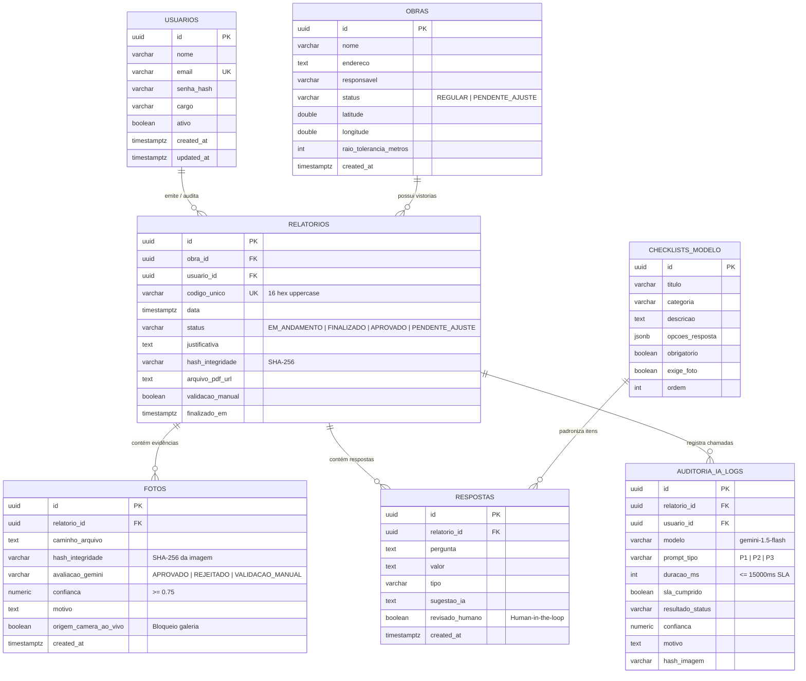

# 🗄️ Supabase & PostgreSQL - BBVision

Arquitetura e modelagem oficial de banco de dados relacional **PostgreSQL** para o sistema **BBVision (Fiscalização Remota de Obras - Banco do Brasil)**, desenvolvido no programa **Residência em Software & IA (Porto Digital / TakeOff)**.

Todo o desenvolvimento segue rigorosamente a **Seção 7 e Seção 4.1** do [`docs/TAKEOFF_DOCUMENTO_ENTREGA.md`](../docs/TAKEOFF_DOCUMENTO_ENTREGA.md).

---

## 📊 Diagrama Entidade-Relacionamento (MER)



---

## 🔒 Princípios de Inviolabilidade no Banco de Dados

1. **Imutabilidade em Nível de Engine:**
   - A trigger `trg_bloqueio_relatorio_finalizado` impede a alteração do `codigo_unico`, `hash_integridade`, `obra_id`, `usuario_id` e impede o retorno de status para `'EM_ANDAMENTO'`.
2. **Proteção de Evidências Fotográficas:**
   - A trigger `trg_bloqueio_fotos_relatorio_finalizado` lança exceção imediata caso qualquer processo tente inserir, atualizar ou excluir fotos de um relatório cujo status já esteja em `'FINALIZADO'`, `'APROVADO'` ou `'PENDENTE_AJUSTE'`.
3. **Bloqueio de Checklist:**
   - A trigger `trg_bloqueio_respostas_relatorio_finalizado` garante que respostas de vistorias concluídas nunca sejam modificadas.
4. **Trilha de Auditoria Multimodal:**
   - Tabela `auditoria_ia_logs` armazena carimbo temporal, modelo utilizado, tempo de resposta (`duracao_ms`), SLA (`sla_cumprido <= 15s`), nível de confiança e hash da imagem analisada.

---

## 🗂️ Stored Procedures & Funções

- `fn_finalizar_relatorio(p_relatorio_id, p_codigo_unico, p_hash_integridade, p_arquivo_pdf_url, p_validacao_manual)`:
  Executa a finalização atômica, atribui o código único e carimbo de encerramento.
- `fn_auditar_vistoria(p_relatorio_id, p_fiscal_id, p_status, p_justificativa)`:
  Registra o parecer de auditoria do fiscal Mariana e atualiza o status da obra em cascata (`REGULAR` ou `PENDENTE_AJUSTE`).
- `fn_calcular_distancia_metros(lat1, lon1, lat2, lon2)`:
  Calcula a distância geodésica (fórmula de Haversine) entre o dispositivo e a obra para validação de Geofencing.

---

## 📈 Views Analíticas Criadas

- **`vw_painel_auditoria`:**
  Consolida a visão para o painel de Mariana, apresentando dados da obra, da empreiteira, contagem de fotos validadas pelo Gemini, média de confiança e status do PDF.
- **`vw_governanca_ia`:**
  Relatório executivo para diretoria do Banco do Brasil comprovando cumprimento do SLA de latência (<= 15s), confiança média e taxa de aprovação visual.

---

## 🚀 Como Aplicar no Supabase

### Opção 1: Via Supabase Dashboard (Web)

1. Abra o [Supabase Dashboard](https://supabase.com/dashboard) do seu projeto.
2. Navegue até **SQL Editor**.
3. Execute o script de migração:
   - [`supabase/migrations/20261008000000_bbvision_complete_database.sql`](./migrations/20261008000000_bbvision_complete_database.sql)
4. Em seguida, execute a carga inicial de sementes:
   - [`supabase/seed.sql`](./seed.sql)

### Opção 2: Via Supabase CLI (Local)

```bash
# Iniciar ambiente local
npx supabase start

# Aplicar migrações e sementes
npx supabase db reset

# Enviar para projeto remoto
npx supabase link --project-ref seu-project-id
npx supabase db push
```

---

## 🔐 Configuração no Backend (`backend/.env`)

```env
SUPABASE_URL=https://seu-projeto.supabase.co
SUPABASE_ANON_KEY=sua-anon-key-aqui
SUPABASE_SERVICE_ROLE_KEY=sua-service-role-key-aqui
```
